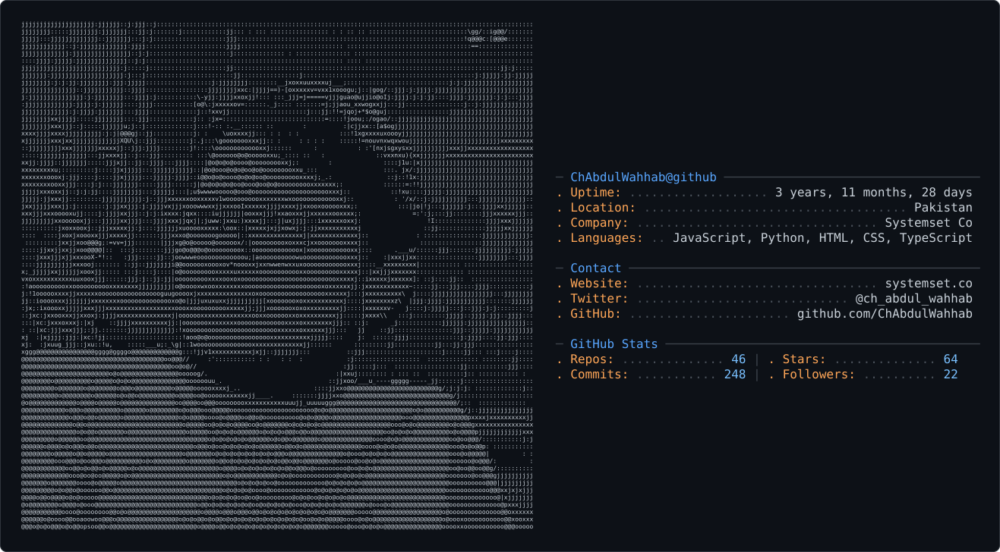

<picture>
  <source media="(prefers-color-scheme: dark)" srcset="dark_mode.svg" />
  <source media="(prefers-color-scheme: light)" srcset="light_mode.svg" />
  
</picture>

# Ch. Abdul Wahab
**Software Engineer** · Python · Django · Node.js · Karachi, PK

---

3+ years shipping real products — not just demos. Currently PM/Engineer at **[Systemset Co](https://github.com/Systemset-Co)**.

- **[Mezbaan](http://mezbaan.systemset.co/)** — Event planning platform. Remote venue booking for guests and hall owners.
- **[Sahulat PK](https://play.google.com/store/apps/details?id=com.publicservices.pakistan&hl=en)** — React Native app. Offline-first government helplines directory.
- **[DealSafe](https://dealsafepk.vercel.app)** — Freelance escrow platform. Multi-currency, milestone-based payments.
- **[Acadly](https://acadly.systemset.co)** — Student-teacher platform with real-time chat & public profiles.
- **[Noor-ul-Basar](https://noor-ul-basar.netlify.app/)** — AI Chrome Extension. On-device ML, zero data sent externally.

---

**Stack**

**Strengths:** API Design · Auth & RBAC · Serverless (Cloudflare Workers/D1) · App Security

---

**Open Source**

| Package | Registry | Description |
|---|---|---|
| [@chabdulwahab/flowcap](https://www.npmjs.com/package/@chabdulwahab/flowcap) | npm | Zero-dependency HTTP rate limiting middleware for Express, Fastify, Koa, and vanilla Node. Sliding window, built-in presets, IETF draft-8 compliant. |
| [@chabdulwahab/api-spy](https://www.npmjs.com/package/@chabdulwahab/api-spy) | npm | Express middleware that renders a live performance dashboard at the bottom of your terminal. Zero deps, under 5KB. |
| [@chabdulwahab/env-ok](https://www.npmjs.com/package/@chabdulwahab/env-ok) | npm | Drop-in env variable guard for Node.js + TypeScript. Validates `.env` against `.env.example` before your app boots. Under 2KB. |
| [projex-cli](https://pypi.org/project/projex-cli/) | PyPI | CLI to scaffold production-ready Python projects (FastAPI/Django + Docker + CI/CD) |
| [py-api-spy](https://pypi.org/project/py-api-spy/) | PyPI | Zero-dependency terminal dashboard for Python web frameworks |
| [secupy](https://pypi.org/project/secupy/) | PyPI | Encryption, hashing & asymmetric encryption library |
| [FlaskSecureKeyGen](https://pypi.org/project/flasksecurekeygen/) | PyPI | Secure secret key generator for Flask apps |

---

